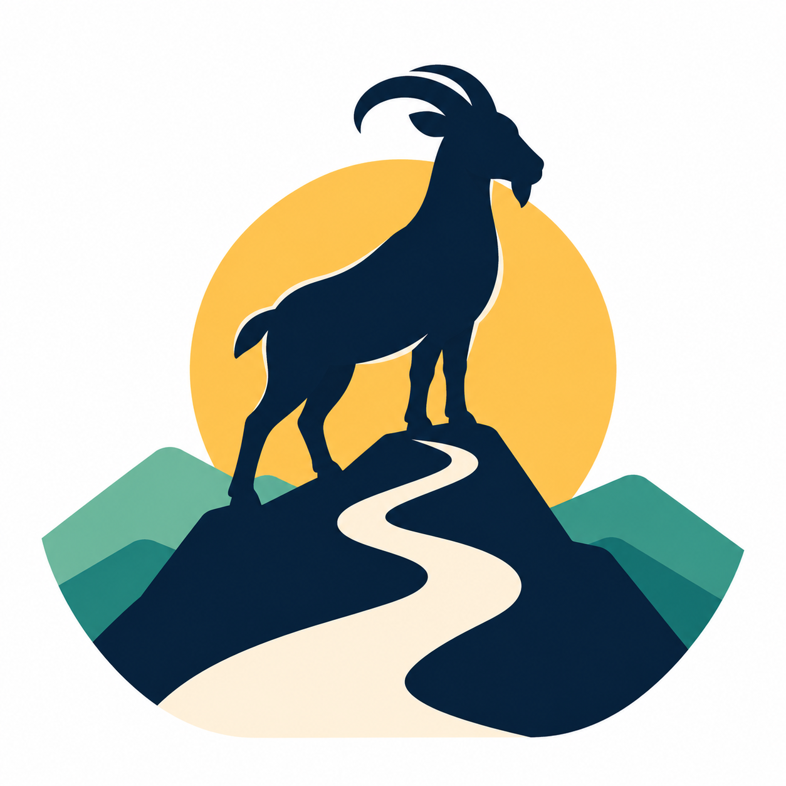
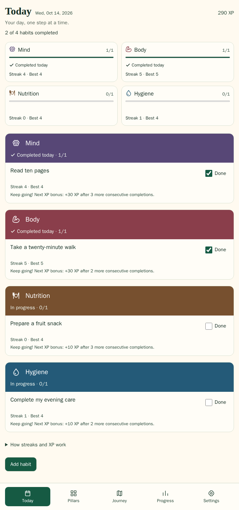
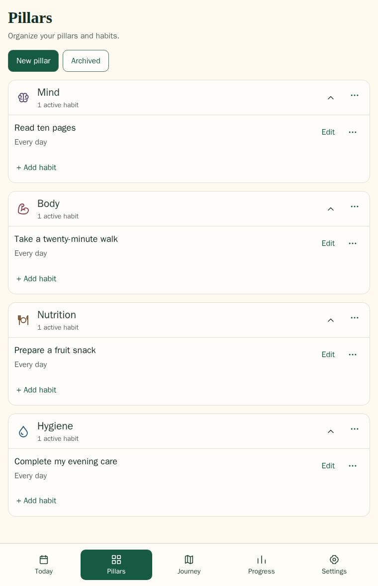
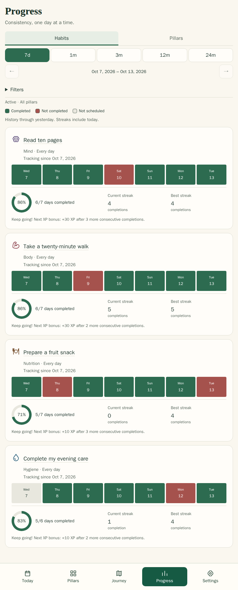

<p align="center">
  
</p>

<h1 align="center">My GOAT Journey</h1>

<p align="center"><strong>Small habits. A greater you.</strong></p>

<p align="center">
  Build meaningful habits across different areas of life, organized into pillars.<br>
  Track your consistency, celebrate your progress, and follow your journey up the mountain.
</p>

<p align="center">Start with just one habit — you don't need to fill every pillar.</p>

<p align="center">
  No account required · Flexible weekday schedules · Habit records stored in your browser
</p>

<p align="center">
  <a href="LICENSE"></a>
  <a href="https://github.com/thobiast/my-goat-journey/actions/workflows/check-build.yml"></a>
</p>

<p align="center">
  <a href="https://thobiast.github.io/my-goat-journey/app/">Open the app</a> ·
  <a href="https://thobiast.github.io/my-goat-journey/">Explore My GOAT Journey</a> ·
  <a href="#screenshots">Screenshots</a> ·
  <a href="#run-locally">Run locally</a> ·
  <a href="#documentation-and-contributing">Documentation</a>
</p>

## Screenshots

Today, Pillars and Progress with fictional sample data. Select an image to view it
full size.

<p>
  <a href="docs/screenshots/readme/today-en.png"></a>
  <a href="docs/screenshots/readme/pillars-en.png"></a>
  <a href="docs/screenshots/readme/progress-en.png"></a>
</p>

## Habits that fit your life

Every habit shapes your journey. You choose the habits and frequency; here are a few ideas to get started.

| Pillar | Habit | Schedule |
|---|---|---|
| Mind | Read 10 pages | Every day |
| Mind | Practice English for 15 minutes | Weekdays |
| Body | Exercise for 45 minutes | Monday, Wednesday, Friday |
| Body | Do 30 push-ups | Tuesday, Thursday, Saturday |
| Nutrition | Eat a piece of fruit with breakfast | Every day |
| Nutrition | Add vegetables to lunch | Every day |
| Hygiene | Floss before bed | Every day |
| Hygiene | Replace your bed sheets | Saturday |

## What you can do

- Make room for what matters with custom pillars and multiple habits per pillar.
- Focus on what's due today with a checklist grouped by pillar.
- Spot patterns in consistency calendars and current/best streaks for habits, pillars and your daily agenda.
- Celebrate completed goals with XP, milestone bonuses, levels and a mountain journey.
- Use the app in English or Brazilian Portuguese; your goals and pillar names stay as entered.

See the [product specification](docs/product-specification.md) for scheduling,
corrections and retained history. Completion is self-reported. This is not a
clinical tool, and XP and levels do not measure health, intelligence or personal worth.

## Your data and offline use

No account or login is needed. Records stay local to your device's browser profile
and origin, with no cross-device synchronization. Browser storage can be lost
through clearing site data, eviction or removing an installation, so **export
backups regularly** in Settings. Exported files contain your goals and history
and are not encrypted by the app; keep them private. The
[backup and storage guide](docs/pwa-reliability.md#backup-storage-identity-and-moving-a-diary)
explains storage identity, safe transfers and validated, confirmed restore that
**replaces, never merges**, local records.

For offline use, open the production app online, let offline preparation finish,
then reopen it once while still online. Core tracking can then work offline while
browser storage remains available. **Installation is optional** and does not by
itself guarantee offline readiness or permanent storage. The landing page requires
a connection. See [offline setup](docs/pwa-reliability.md#first-installation-and-offline-continuity),
[secure-context requirements](docs/pwa-reliability.md#production-and-development-operation)
and [troubleshooting](docs/pwa-reliability.md#troubleshooting) for supported browsers
and help.

## Run locally

The documented Linux workflow requires existing **rootless Podman**, a POSIX
shell, a source checkout and initial network access. Local application tools and
browser dependencies stay in containers; you don't need host Node/npm.

From the repository root:

```sh
sh scripts/containers.sh bootstrap
sh scripts/containers.sh dev
```

Bootstrap installs from the committed lockfile with `npm ci`.

- Landing: http://localhost:5173/my-goat-journey/
- App: http://localhost:5173/my-goat-journey/app/

<details>
<summary>Build and run the production app locally</summary>

```sh
sh scripts/containers.sh build-prod
sh scripts/containers.sh run-prod
```

- Landing: http://localhost:8088/my-goat-journey/
- App: http://localhost:8088/my-goat-journey/app/

Stop the named development/runtime containers while preserving volumes:

```sh
sh scripts/containers.sh stop
```

</details>

Preview ports **5173 and 8088 bind to `0.0.0.0`**, so use a trusted network.
These commands do not configure HTTPS or a firewall. For checks, alternate
`SITE_PREFIX` values and fixture preparation, see [Development](docs/development.md).
Local execution remains containerized; GitHub-hosted application CI runs the shared
commands directly on its disposable runner.

## Documentation and contributing

| Document | When to use it |
|---|---|
| [Product specification](docs/product-specification.md) | Product rules, acceptance criteria and future scope. |
| [Development](docs/development.md) | Setup, commands, CI boundaries and test fixtures. |
| [Interface contracts](docs/interfaces.md) | Module, persistence and UI behavior. |
| [PWA reliability](docs/pwa-reliability.md) | Installation, offline use, updates and backup safety. |
| [Branding](docs/branding-pwa.md) | Source assets, icon generation and provenance. |
| [Contributing](CONTRIBUTING.md) | Contribution conventions, safe fixtures and review guidance. |

## Status and roadmap

See [device coverage and limitations](docs/pwa-reliability.md#device-coverage-and-limitations)
for browser installation and storage considerations.

Avatar/cosmetic personalization, an achievement catalog and reminders/notifications
are future work, not shipped features.

## Hosting and CI

Source code: [thobiast/my-goat-journey](https://github.com/thobiast/my-goat-journey).
GitHub Pages hosts the [landing page](https://thobiast.github.io/my-goat-journey/)
and [app](https://thobiast.github.io/my-goat-journey/app/).

[Check and build](.github/workflows/check-build.yml) validates and builds without
deploying; [Pages publication](.github/workflows/publish-pages.yml) is a separate
manual workflow. See [CI details](docs/development.md#github-hosted-application-ci)
and [publication instructions](docs/development.md#manual-github-pages-publication)
for workflow behavior, coverage and deployment procedures.

## License and artwork

The project's own code, documentation and original assets, including the supplied
logos and derived installation icons, are licensed under [Apache 2.0](LICENSE),
to the extent of the rights available to license. No separate restrictive branding
policy is added.

Third-party material retains its existing terms; see [third-party notices](public/third-party-notices.txt)
and adjacent vendored-icon notices. [Branding provenance](docs/branding-pwa.md#artwork-provenance-and-attribution)
records AI-assisted artwork generation and the limits of the available attribution.
